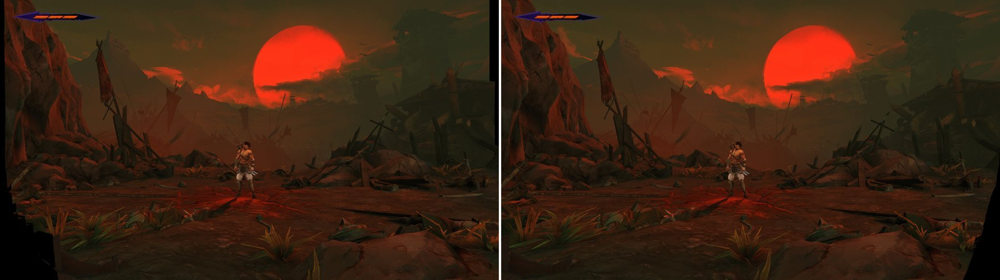
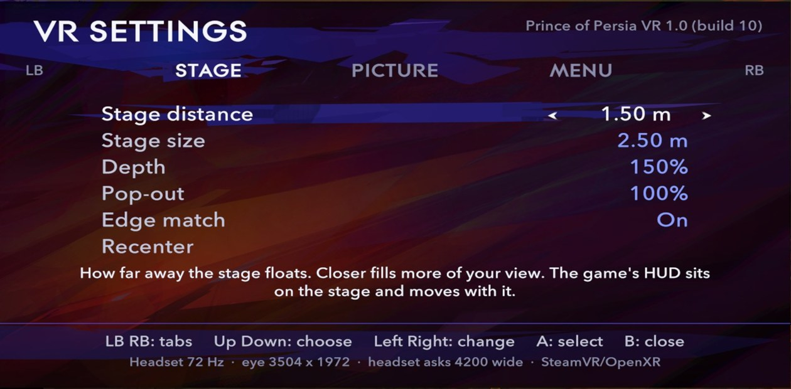
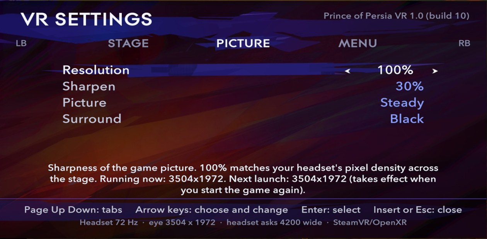
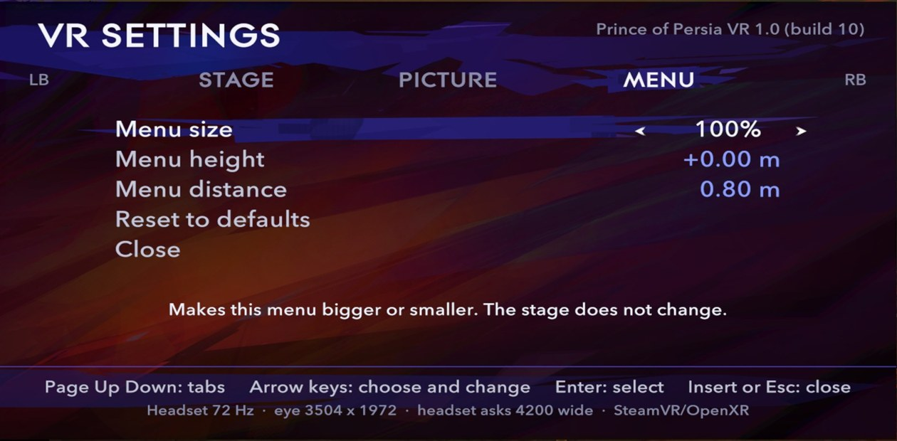

# Prince of Persia: The Lost Crown VR

True stereo VR for Prince of Persia: The Lost Crown. Both eyes are drawn from the same game tick, so there is no alternate-eye shimmer and no warping. The game becomes a diorama floating in front of you: its real 3D world stays 3D, so backgrounds sit behind the stage and the Prince and the foreground come out toward you. You play seated with a gamepad; there are no motion controls.



**Download:** see [Releases](../../releases).

**Support:** this mod is free. If you enjoy it, you can [buy me a coffee](https://buymeacoffee.com/scubasteve2365).

## What you need

- The Steam version of Prince of Persia: The Lost Crown, with your Ubisoft account signed in (the game needs it)
- A PC VR headset with an OpenXR runtime. Two have been tested:
  - SteamVR, set as your OpenXR runtime (SteamVR settings, OpenXR)
  - Virtual Desktop's VDXR, for headsets like the Meta Quest 3
- A gamepad (Xbox type; PlayStation pads through Steam Input)

## Install

1. Unzip the release anywhere.
2. Double click `Install LostCrownVR.bat` and type 1. It finds the game through Steam.
3. Start SteamVR or connect Virtual Desktop, then start the game from Steam. VR starts by itself.

To uninstall, run the same bat file and type 2. No game files are changed.

If another mod already uses `winhttp.dll` in the game folder, the installer renames it to `winhttp_chain.dll` and this mod loads it first, so both keep working. Uninstall puts it back.

The mod is not signed, so Windows may warn you about the bat file. It is plain text, so you can read it first.

If the game stays flat, open the menu (hold both sticks, or press Insert). It tells you if VR did not start and why. If no OpenXR runtime is set and SteamVR is installed, the mod uses SteamVR for this game. Nothing on your PC is changed.

## Settings

Hold both sticks in for half a second to open the menu in the headset, or press Insert on the keyboard. The game pauses and gets no input while it is open. LB and RB (Page Up and Page Down) switch tabs, up and down choose a setting, left and right change it, A (Enter) selects and B (Esc) closes. Every row shows a short explanation at the bottom of the menu. The menu is drawn in the game's own font and menu art, loaded from the game while it runs.

### Stage



| Setting | What it does |
|---|---|
| Stage distance, Stage size | Where the stage floats and how big it is |
| Depth | How strong the 3D is. Higher makes the world feel deeper and smaller |
| Pop-out | Brings the Prince and more of the scene out of the stage toward you, and eases far backgrounds. Default 100% |
| Edge match | At the left and right edges of the stage, each eye shows only the part of the world both eyes can see, near or far. What only one eye could see is hidden in the Surround colour. On by default |
| Recenter | Puts the stage and the menu in front of you again. Your headset's own recenter does the same |

### Picture



| Setting | What it does |
|---|---|
| Resolution | 100% matches your headset's pixel density across the stage. Takes effect the next time you start the game |
| Sharpen | Crisper edges. 0% turns it off. Default 100% |
| Picture | Auto picks Steady on Virtual Desktop and Floating Panel on everything else. Steady draws the stage into each eye's view and holds still under Virtual Desktop. Floating Panel can look a little sharper, but Virtual Desktop squashes and shears it when you turn your head |
| Surround | What you see around the stage. Black is the original look. Green fills it with pure green for Virtual Desktop's chroma-key passthrough, so your room shows around the game. Transparent asks your headset software to show your room itself, where it offers that, otherwise black |

### Menu



| Setting | What it does |
|---|---|
| Menu size, height, distance | Where this menu floats. The stage does not change |
| Reset to defaults | Puts every setting back to how it started |
| Close | Closes the menu |

## Game settings

While VR runs the mod keeps the game's VSync and frame limit off, because it paces the game to your headset, and it turns off the screen effects that look wrong in VR: bloom, vignette, chromatic aberration, depth of field, motion blur, film grain and ambient occlusion. Your game settings themselves are not changed.

## Performance tips

- **SteamVR throttling first.** In SteamVR Settings, Video, Per-application video settings, pick the game and set **Throttling Behavior** to **Fixed** at your headset's refresh rate, and turn **Motion Smoothing** off.
- **72 or 90 Hz is plenty.** The game is light, and game speed holds at 72, 90 and 120 Hz.

## Good to know

- The game needs your Ubisoft account signed in. The mod stops the game's own web requests that go through the game's code; Ubisoft Connect's own connection is outside the game and is not touched. Don't use online features with the mod.
- Ubisoft Connect sometimes stops while starting the game (its log says "Cannot switch modes after logging in") and nothing appears. That is Ubisoft's launcher, not the mod: wait a minute and start the game again.
- The game's HUD sits on the stage. Story videos play on the stage in 3D.
- Tested in real headsets on a Pimax through SteamVR and on a Meta Quest 3 through Virtual Desktop's VDXR, on NVIDIA graphics. Other headsets and graphics cards should work through OpenXR but have not been tried. Reports are welcome.
- No DLSS or other upscaler; the game is light enough not to need one.
- If something goes wrong, the log is `LostCrownVR.log` in the game folder. Please attach it to an issue.

## Support

This mod is free. If you enjoy it and want to support more VR mods, you can
[buy me a coffee](https://buymeacoffee.com/scubasteve2365). Thank you!

## Building from source

You need Visual Studio's C++ tools with CMake, the Khronos [OpenXR loader](https://github.com/KhronosGroup/OpenXR-SDK-Source/releases) 1.1.65 for Windows, [MinHook](https://github.com/TsudaKageyu/minhook) source, [Dear ImGui](https://github.com/ocornut/imgui) 1.93 and the [Jost](https://fonts.google.com/specimen/Jost) font (the fallback menu font).

```
cmake -S . -B out -A x64 -DOPENXR_DIR=<OpenXR loader folder> -DMINHOOK_DIR=<MinHook folder> -DIMGUI_DIR=<imgui folder> -DFONTS_DIR=<folder with Jost.ttf>
cmake --build out --config Release
```

The output lands in `..\build`. `install\make_package.py` builds the release zip.

## Credits

Built with the Khronos [OpenXR loader](https://github.com/KhronosGroup/OpenXR-SDK-Source) (Apache-2.0), [MinHook](https://github.com/TsudaKageyu/minhook) (BSD-2) and [Dear ImGui](https://github.com/ocornut/imgui) (MIT). Font: Jost (SIL OFL 1.1). The sharpening pass follows the idea of AMD FidelityFX Contrast Adaptive Sharpening (MIT). Lyall's [PoPTLCFix](https://github.com/Lyall/PoPTLCFix) (MIT) mapped the game's resolution, UI and post-effect classes; no code was copied. The way into the game follows the idea of BepInEx's Doorstop; no code was copied. The diorama design and the XR side come from [Ori VR](https://github.com/scubasteve2365/OriVR), [Cuphead VR](https://github.com/scubasteve2365/CupheadVR) and [Ori and the Will of the Wisps VR](https://github.com/scubasteve2365/OriWotWVR) by the same author. Licences are in the release zip.

MIT licensed, by scubasteve2365. This is a fan mod, not made or approved by Ubisoft. It contains no game files.
